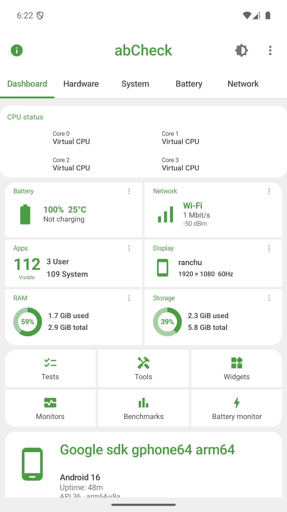
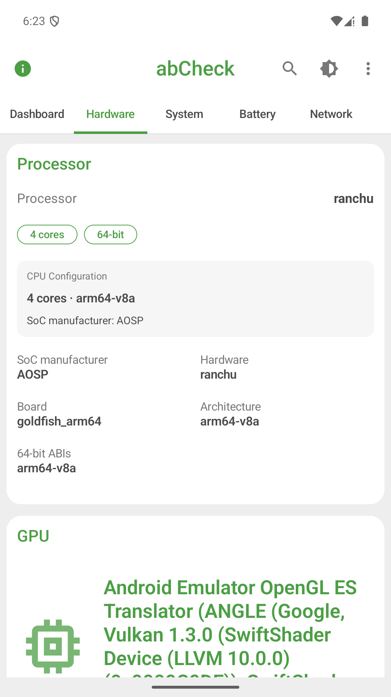
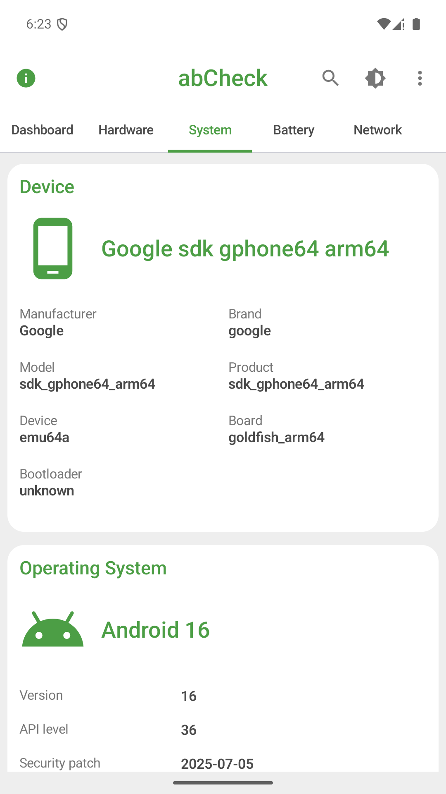
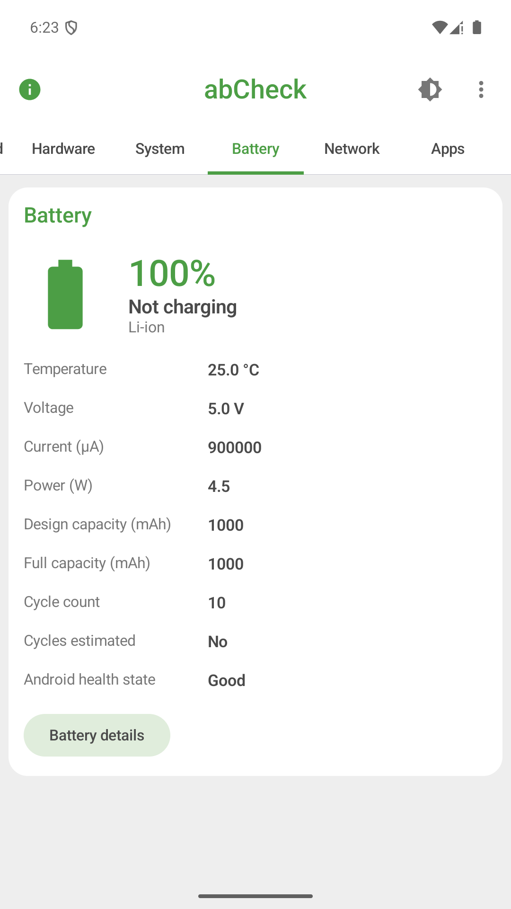
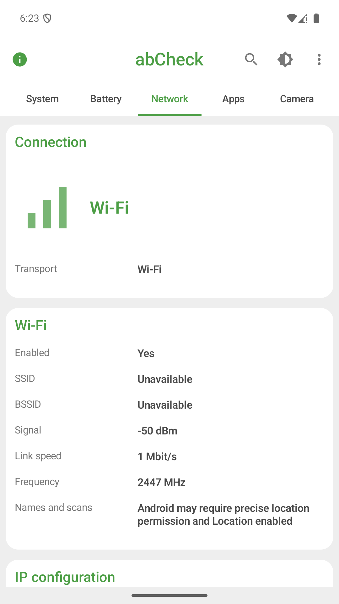
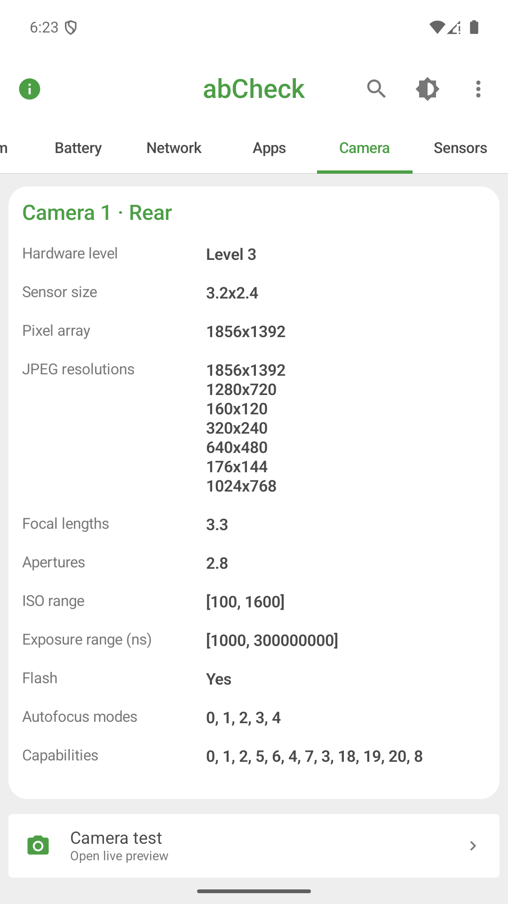
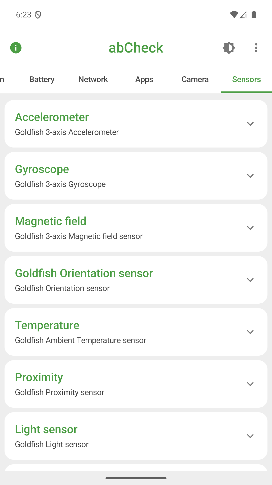
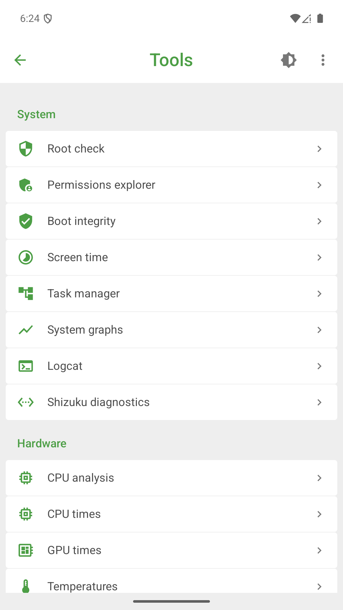

<h1 align="center">abCheck</h1>
<p align="center"><strong>Device & System diagnostics for Android</strong><br />Formerly ABattery / Battery Health & Cycles</p>

<p align="center">
  <a href="https://github.com/abanana84/abCheck/actions/workflows/android.yml"></a>
  <a href="https://play.google.com/store/apps/details?id=com.abanana.abattery"></a>
  <a href="LICENSE"></a>
  
</p>

abCheck brings device information, hardware tests, live monitoring and battery diagnostics into one open-source Android app. No ads, analytics or account required. Core diagnostics work without root; optional Shizuku tools need a separate setup.

> **Release status - 22 October 2026:** Version 1.2.0 (code 9) has been uploaded to Google Play and submitted for review. The screenshots and features below describe that update and the source on `main`. Play may still deliver the older battery-focused version until the update is approved. Existing GitHub releases 1.1.x are historical ABattery builds.

[Google Play](https://play.google.com/store/apps/details?id=com.abanana.abattery) · [Report a bug](https://github.com/abanana84/abCheck/issues/new?template=bug.yml) · [Request a feature](https://github.com/abanana84/abCheck/issues/new?template=feature.yml) · [Privacy policy](PRIVACY.md)

## What you can check

| Area | Tools and information |
| --- | --- |
| Dashboard | CPU cores and available frequencies, RAM, storage and battery overview |
| Hardware & system | Chipset, display, Android build, memory and device properties |
| Battery | Level, temperature, voltage, current, power, available capacity and cycle signals, current chart and local recording |
| Network | Connection information, user-started DNS/TCP connectivity tools, Wi-Fi, Bluetooth, GPS and USB diagnostics |
| Apps, camera & sensors | Android-visible packages, camera capabilities, sensor details and live readings |
| Interactive tests | Screen, multitouch, keys, audio, microphone, camera and sensor checks |
| Monitoring & reports | Floating monitor, graphs, home-screen widgets and Text/JSON/HTML/PDF/PNG reports |
| Local benchmarks | CPU, memory, storage and GPU workloads, repeated runs and saved history |

Light, dark and system themes are supported. Existing battery screens retain 16 languages; the expanded diagnostic interface has English and Vietnamese labels, with English fallbacks where translations are missing.

## Screenshots of 1.2.0

Captured from the app on an Android emulator. Hardware values describe that emulator, not a physical phone.

<p align="center">
  
  
  
  
</p>
<p align="center">
  
  
  
  
</p>

## Honest measurements and device limits

Android and manufacturers restrict access to some hardware data. Unavailable readings remain `N/A`; estimates are labeled. Emulator CPU frequencies are identified as virtual rather than presented as measured MHz. Historical battery cycles before installation cannot be reconstructed when the device does not expose them.

Local benchmark scores describe abCheck workloads; they are not interchangeable with other benchmark apps. Physical hardware tests, OEM-specific readings and behavior across Android versions still need real-device verification. There are no online rankings or signed Play Integrity verdicts in this version.

The [community-tested device list](docs/device-compatibility.md) records reports about earlier battery-focused versions. Those reports do not validate every tool introduced in 1.2.0. Read [how Android battery data works](docs/android-battery-data.md) for details about APIs and fallbacks.

## Privacy and permissions

Diagnostics and history are processed locally. Camera, microphone, location, Bluetooth, usage access, notifications and overlay access are used by the corresponding tools. The floating monitor and battery recorder are user-started sessions with a visible notification and Stop action.

Version 1.2.0 includes Internet permission for connectivity tools you choose to run. It does not include advertising or analytics SDKs. Reports leave the app only when you choose to export or share them. See the [privacy policy](PRIVACY.md) for the full permission and data-use details.

## Build from source

Requirements: JDK 17, Android SDK 36, and Android 8.0 (API 26) or newer on the target device.

```bash
git clone https://github.com/abanana84/abCheck.git
cd abCheck
./gradlew testDebugUnitTest lintDebug assembleDebug
```

The debug APK is generated at `app/build/outputs/apk/debug/app-debug.apk`. For device integration checks with an attached emulator or phone:

```bash
./gradlew connectedDebugAndroidTest
```

The Android package remains `com.abanana.abattery` so this update continues the existing app. Renaming the GitHub project does not change the installed package or Play URL.

## Development and contributing

Built with Kotlin, Jetpack Compose, Material 3, Hilt, coroutines and StateFlow. See the [source architecture](docs/architecture.md), [changelog](CHANGELOG.md) and [contribution guide](CONTRIBUTING.md).

Device reports, translations and focused fixes are welcome. Include the model, Android version, app version and steps to reproduce; remove device identifiers and unrelated personal information from screenshots or logs.

## License

[Apache License 2.0](LICENSE).
